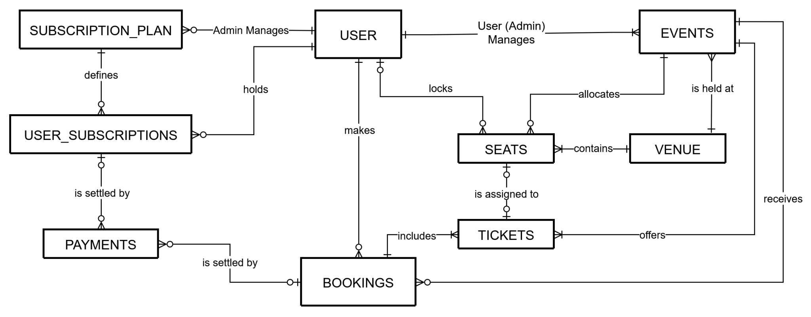
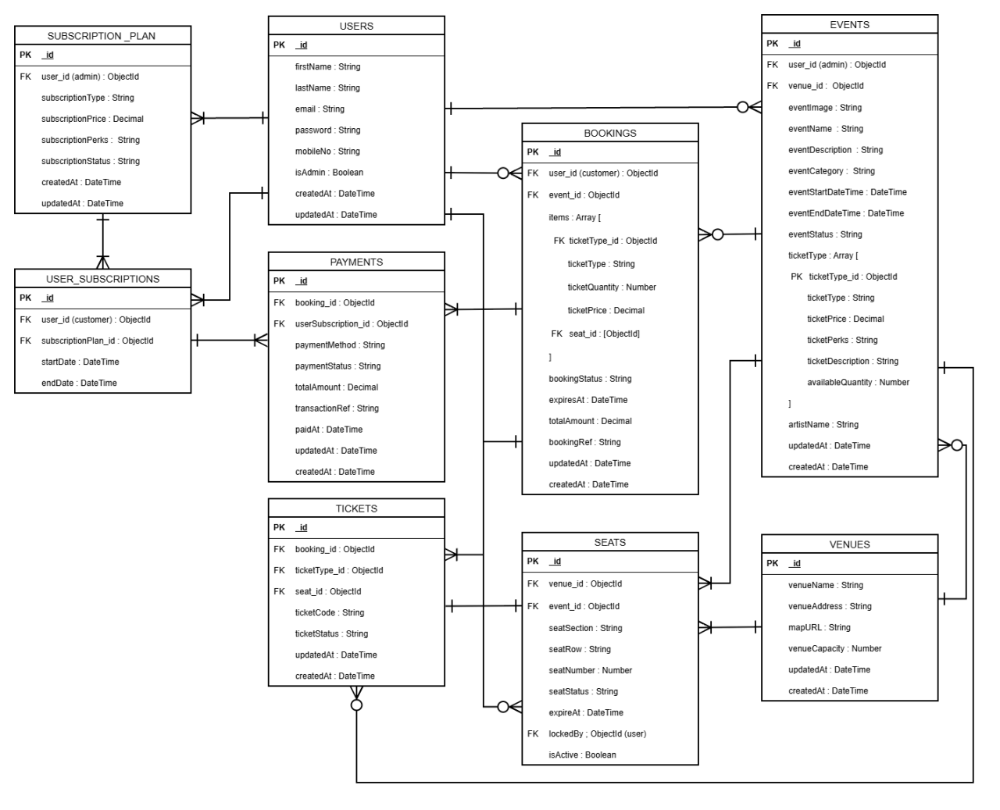

# Technical Specifications Document

## 1. Title Page
- **Project Name**: G1: Event Booking System
- **Version**: 1.0
- **Date**: October 19, 2026
- **Author(s)**: Dan Michael Alfaras, Matthew Antonio Bulaong, Jovie Cleofas, Aaron Angelo Crisologo

## 2. Table of Contents
1. [Introduction](#3-introduction)
2. [Overall Description](#4-overall-description)
3. [Visual Mockup Reference](#5-visual-mockup-reference)
4. [Features](#6-features)
5. [Functional Requirements](#7-functional-requirements)
6. [Non-Functional Requirements](#8-non-functional-requirements)
7. [Data Requirements](#9-data-requirements)
8. [External Interface Requirements](#10-external-interface-requirements)
9. [Glossary](#11-glossary)
10. [Appendices](#12-appendices)

## 3. Introduction
- **Overview**: The G1 Event Booking System is a centralized web-based application designed for browsing upcoming concerts and special events, viewing event details, booking tickets online, and enrolling in tiered memberships. It also equips administrators with tools to manage event listings, venues, ticket categories, membership plans, user records, and booking transactions. As a mock system and side project, it demonstrates core concepts of web development, database management, authentication, and booking management within the defined scope.
- **Purpose**: 
  - Provide attendees with an organized platform to discover events, check schedules and real-time seat/ticket availability, secure digital tickets, and review booking history.
  - Enhance customer experience through Bronze, Silver, and Gold membership plans offering ticket discounts, presale access, and member-only perks.
  - Provide administrators with a centralized management tool to maintain event listings, monitor bookings, and oversee user records.
- **Scope**: 
  - **In Scope**: User registration and authentication, event browsing and filtering, ticket tier and seat selection, booking confirmation and digital ticket access, membership plan comparison and subscription management, and administrative CRUD operations for events, ticket categories, membership plans, user records, and bookings.
  - **Out of Scope**: Physical ticket printing and delivery, transportation and accommodation booking, physical venue management, and a separate native mobile application.
- **Definitions, Acronyms, and Abbreviations**: 
  - **G1 Event Booking System**: The web-based application that allows users to browse events and create bookings.
  - **User**: An individual visiting the website to browse events, create bookings, and update their profile.
  - **Admin**: An authorized individual responsible for creating, updating, and managing events and overseeing booking records.
  - **Event**: An organized activity, such as a concert, listed in the system.
  - **Booking**: A record created when a user submits a request to reserve one or more tickets for an event.
  - **Database**: An organized collection of data used to store and manage user accounts, event information, and booking information (Silberschatz et al., 2020).
- **References**: 
  - Coulouris, G., Dollimore, J., Kindberg, T., & Blair, G. (2011). *Distributed systems: Concepts and design* (5th ed.). Addison-Wesley.
  - Silberschatz, A., Korth, H. F., & Sudarshan, S. (2020). *Database system concepts* (7th ed.). McGraw-Hill Education.
  - Sommerville, I. (2016). *Software engineering* (10th ed.). Pearson.

## 4. Overall Description
- **Product Perspective**: A standalone, client-server web application built on the MEVN stack (MongoDB, Express.js, Vue.js, Node.js) that replaces manual ticketing workflows with a centralized platform for attendees and system administrators.
- **Product Functions**: 
  1. **User Registration and Authentication**: Create accounts, log in, log out, and securely manage profile information.
  2. **Event Browsing and Search**: Browse upcoming events, search and filter listings, view event details, check availability, and explore Bronze, Silver, and Gold ticket options.
  3. **Administrative Management**: Manage user records, monitor ticket sales and booking transactions, track ticket availability, and oversee event operations.
  4. **Event Booking & Payment**: Select ticket tiers and seats, place temporary checkout holds, complete online bookings, and process payments through an integrated payment service.
  5. **Booking Management & Ticket Management**: Generate booking references (`bookingRef`) and digital tickets (`ticketCode`) for confirmed transactions; view booking history and ticket statuses.
  6. **Membership Subscription**: Explore and subscribe to Bronze, Silver, and Gold membership plans to unlock ticket discounts, presale access, and member-only offers; monitor subscription status and manage renewals.
- **User Classes and Characteristics**: 
  - **Users / Attendees**: Individuals who browse events, view details, purchase tickets, manage bookings, access digital tickets, update profiles, and use membership benefits. Access is strictly limited to their personal account, bookings, and public event services.
  - **System Admins**: Authorized personnel responsible for creating, updating, and removing event listings, managing ticket categories and membership plans, maintaining booking records, and monitoring user transactions. Access includes all back-office administrative functions required to ensure data accuracy.
- **Operating Environment**: 
  1. **Client Environment**: Desktop computers, laptops, tablets, and smartphones running modern web browsers (Google Chrome, Microsoft Edge, Mozilla Firefox, Safari) with responsive screen adaptation.
  2. **Application Environment**: Vue.js for the client-side user interface; Node.js and Express.js for backend REST API routing, business logic, and database communication.
  3. **Database Environment**: MongoDB Atlas (with Mongoose ODM) for storing user accounts, events, venues, seats, ticket categories, memberships, bookings, and payments.
  4. **Hosting Infrastructure**: Frontend deployed on GitHub's free hosting service (GitHub Pages); backend deployed on a cloud hosting provider such as Amazon Web Services (AWS).
  5. **Network Requirements**: Stable internet connectivity; all client-server traffic encrypted over HTTPS.
  6. **Security Infrastructure**: JSON Web Token (JWT) authentication, Role-Based Access Control (RBAC), Bcrypt password hashing, and third-party payment gateway isolation.
  7. **Hardware Requirements**: Standard consumer devices capable of running a modern browser for clients; cloud server instances with sufficient CPU, memory, and storage to handle application logic and database queries.
- **Assumptions and Dependencies**: 
  - **Assumptions**:
    - Users and administrators have access to an internet-connected device and compatible browser.
    - Users provide accurate registration details, and administrators maintain accurate event, pricing, and membership data.
    - Stakeholders will provide timely business rules, workflows, and feedback.
    - Users have appropriate permissions for their role, and the MEVN stack supports all target features.
    - Payment gateway integration and email/notification services will be implemented post-MVP once core MVP requirements are completed.
  - **Dependencies**:
    - **Database Service**: MongoDB Atlas for persistent storage.
    - **Application Technologies**: Vue.js, Node.js, Express.js, and Mongoose.
    - **Hosting & Network**: GitHub Pages, AWS (or equivalent cloud host), and stable internet connectivity.
    - **External Services (Post-MVP)**: Third-party payment gateway for transaction processing and an external email/notification provider for transactional emails.
    - **Stakeholder Support**: Timely requirement approvals and user acceptance testing.

## 5. Visual Mockup Reference
- **Link or Screenshot**: [G1: Event Booking System Figma Visual Mockup](https://www.figma.com/design/GEkylbxWNNZ7c7XL5YBRtb/Event-Booking-Side-Project?node-id=0-1&t=MZUb4SSz7qulHcHh-1)

## 6. Features
- **Search & Navigation**: Global search bar and top-level navigation linking the Homepage, Event Listings, About Us, Contact Us, and Membership pages.
- **User Accounts & Profile Management**: Account registration, login/logout, personal profile editing, password change/recovery, upcoming event checks, and booking history access.
- **Homepage & Featured Shows**: Hero carousel showcasing featured performances and popular shows, key event highlights (dates, venues, starting prices), quick navigation links, and a Frequently Asked Questions (FAQ) section.
- **Event Listings**: Browsable catalog organized by category and month, supporting keyword search, multi-criteria filtering (location, venue, price, genre), an interactive calendar for date-based discovery, and real-time availability badges.
- **Event Details & Booking**: Comprehensive event view (description, schedule, venue, performers, rules), ticket tier comparison, seat selection, temporary seat-hold timer, order summary, payment processing, and digital ticket issuance.
- **Contact Us and About Us Page**: Organizational background, service overview, support contact details (email, phone, social media), terms/policies links, and an interactive inquiry/feedback submission form.
- **Membership and Subscriptions**: Side-by-side comparison of Bronze, Silver, and Gold membership tiers, pricing, and perks (ticket discounts, priority booking, presale access, exclusive offers), plus enrollment, status tracking, and renewal/upgrade management.
- **Email and Notifications**: Automated email alerts for booking confirmations, payment receipts, digital ticket availability, membership enrollments/renewals, event reminders, schedule changes, and cancellations.

## 7. Functional Requirements

### Use Cases
- **Use Case 1: Register and Manage User Account**
  - **Title**: User Account Registration and Profile Management
  - **Description**: Allows users to create accounts, authenticate, update profile information, and access their booking history.
  - **Actors**: Guest, Registered User
  - **Preconditions**: The guest has access to the application and possesses a valid, unregistered email address.
  - **Postconditions**: The account is created, accessed, or updated successfully.
  - **Main Flow**: 
    1. User selects the registration or login option.
    2. System displays the corresponding form.
    3. User enters the required information.
    4. System validates the submitted information.
    5. System creates the account or authenticates the user.
    6. User accesses their profile and available account features.
  - **Alternate Flows**: 
    - *4a (Empty/Invalid Fields)*: System displays validation errors and prompts correction.
    - *4b (Weak Password)*: System explains password rules and requests a new password.
    - *4c (Duplicate Email)*: System notifies the user and offers login or password reset options.
    - *5a (Invalid Credentials)*: System displays an authentication error and allows retry.
    - *5b (Forgot Password)*: User selects "Forgot password"; system emails a reset link to set a new password.
    - *6a (Unauthenticated Access)*: System redirects unauthenticated users attempting to view profile/booking pages to the login page.
    - *6b (Invalid Profile Update)*: System rejects invalid edits, explains the error, and retains previous data.

- **Use Case 2: Browse Events and View Event Details**
  - **Title**: Event Listings
  - **Description**: Allows users to browse, search, and filter events and view detailed event information.
  - **Actors**: Guests, Registered Users
  - **Preconditions**: Event information is published in the system.
  - **Postconditions**: The user views the selected event's details, venue information, and ticket availability.
  - **Main Flow**: 
    1. User opens the Event Listings page.
    2. System displays available events and summary details.
    3. User searches or filters events by category, date, location, venue, price, or genre.
    4. System displays matching event results.
    5. User selects a specific event.
    6. System displays the event's description, schedule, venue, performers, rules, and available ticket categories.
  - **Alternate Flows**: 
    - *2a (No Events)*: System displays a message stating no events are currently listed.
    - *2b (Load Failure)*: System shows a connection/load error and provides a retry option.
    - *4a (No Matches)*: System displays "No results found" and suggests clearing filters or viewing upcoming events.
    - *4b (Invalid Search Text)*: System prompts the user to enter a valid keyword.
    - *5a (Event Removed/Cancelled)*: System informs the user the event is no longer available and returns to listings.
    - *6a (Sold Out)*: System displays a "Sold out" badge and disables ticket selection.
    - *6b (Detail Load Error)*: System shows an error message with options to go back or retry.

- **Use Case 3: Book Tickets and Complete Payment**
  - **Title**: Event Booking and Payment
  - **Description**: Allows users to select tickets and seats, review booking summaries, place temporary holds, and complete online payments.
  - **Actors**: Registered Users, Payment Gateway
  - **Preconditions**: The selected event is active, tickets/seats are available, and the user is authenticated.
  - **Postconditions**: A successful transaction updates booking and seat statuses to confirmed/booked, records the payment, and generates digital tickets.
  - **Main Flow**: 
    1. User selects an event and ticket category (`ticketType`).
    2. System displays ticket prices, remaining tier quantities, and seat availability.
    3. User selects the desired ticket quantity and specific seats.
    4. System calculates the total cost and displays the booking summary.
    5. User confirms the selection to proceed to checkout.
    6. System creates a `pending` booking record with a countdown timer (`expiresAt`) and locks the selected seats (`lockedBy`) for a limited time.
    7. User selects a payment method; system creates a payment record and submits the request to the payment gateway.
    8. System verifies the payment result.
    9. Upon successful payment, system updates the payment and booking statuses to confirmed, marks seats as booked, and records the issued tickets.
    10. System displays the booking confirmation and makes the digital ticket available in the user's account.
  - **Alternate Flows**: 
    - *1a (Not Logged In)*: System redirects to login/register and returns the user to the booking flow afterward.
    - *2a (Tier Sold Out)*: System marks the tier unavailable and prompts selection of another category.
    - *3a (Quantity Exceeded)*: System rejects quantities exceeding available inventory or per-order limits.
    - *3b (Seat Contention)*: If a chosen seat is already booked or locked by another user during checkout, system prompts the user to pick a different seat.
    - *4a (Membership Discount)*: If the user holds an active membership, system automatically applies the tier discount before displaying the summary.
    - *6a (User Cancels Checkout)*: System updates the pending booking to `cancelled` and releases locked seats.
    - *6b (Hold Timer Expires)*: System expires the pending booking, releases held seats, and notifies the user.
    - *7a (Gateway Unavailable)*: System displays an error and allows retry while the seat-hold timer remains active.
    - *8a (Payment Failed/Declined)*: System logs the failed attempt, shows the failure reason, and allows retry or a different payment method before hold expiry.
    - *8b (Payment Pending)*: System displays a pending state and withholds ticket generation until payment is confirmed.
    - *9a (Post-Payment Save Error)*: If payment succeeds but the booking update fails, system notifies the user and flags the transaction for admin review or refund.

- **Use Case 4: Manage Events and System Records**
  - **Title**: Administrative Management
  - **Description**: Allows administrators to maintain event listings, ticket categories, membership plans, user records, and booking transactions, including overriding booking statuses.
  - **Actors**: System Administrators
  - **Preconditions**: The administrator is logged in and possesses admin privileges (`isAdmin: true`).
  - **Postconditions**: The target system record is created, updated, or removed.
  - **Main Flow**: 
    1. Administrator logs in to the system.
    2. System verifies credentials and administrative permissions.
    3. Administrator selects a management module.
    4. Administrator creates, updates, or removes permitted records.
    5. System validates and saves the changes.
    6. System displays a confirmation message.
  - **Alternate Flows**: 
    - *2a (Invalid Credentials)*: System shows an error message and allows retry.
    - *2b (Unauthorized Role)*: Non-admin accounts are denied access and redirected to the homepage or login page.
    - *3a (Session Expired)*: System prompts re-authentication and returns the admin to the management function.
    - *4a (Insufficient Permission)*: System blocks unauthorized record modifications and displays an error.
    - *4b (Record In Use)*: If deleting a record with active dependencies (e.g., an event with existing bookings), system warns the admin and blocks deletion or offers archival/cancellation.
    - *4c (Admin Cancels)*: System discards unsaved edits and preserves the original record.
    - *5a (Validation Failure)*: System rejects invalid data (e.g., end date before start date, negative ticket price) and highlights the error.
    - *5b (Concurrent Edit Conflict)*: If another admin modified the record simultaneously, system warns of the conflict and prompts review of the latest version.
    - *5c (Database Error)*: System displays an error message and leaves the existing record unchanged.

- **Use Case 5: Membership and Subscription Benefits**
  - **Title**: Membership and Subscription
  - **Description**: Allows users to compare membership plans, enroll, view active benefits, and renew or change plans.
  - **Actors**: Registered Users, Payment Gateway
  - **Preconditions**: User is authenticated and membership plans are configured.
  - **Postconditions**: The user's subscription record and status are created or updated.
  - **Main Flow**: 
    1. User opens the Membership page.
    2. System displays available plans (Bronze, Silver, Gold), prices, and perks.
    3. User compares plans and selects a preferred tier.
    4. System displays the selected plan's details.
    5. User confirms registration and completes payment (if a paid plan).
    6. System records the membership in `User_Subscriptions` and displays active status and benefits.
  - **Alternate Flows**: 
    - *1a (Not Logged In)*: System redirects to login/register and returns to the Membership page.
    - *2a (No Plans Offered)*: System informs the user that no plans are currently available.
    - *2b (Load Failure)*: System displays an error message with a retry button.
    - *3a (Existing Active Membership)*: System displays the user's current plan/status and offers renewal or tier upgrade instead of duplicate enrollment.
    - *5a (User Cancels)*: System returns to the Membership page without creating a record.
    - *5b (Payment Failed/Declined)*: System displays the failure reason and allows payment retry; no membership is activated.
    - *5c (Payment Pending)*: System shows a pending status and waits for payment confirmation before activating perks.
    - *5d (Gateway Unavailable)*: System shows an error message and prompts the user to try again later.
    - *6a (Post-Payment Save Error)*: System notifies the user and flags the payment transaction for administrative review or refund.
    - *6b (Expired Plan Renewal)*: System extends or restarts the subscription window and updates the status to `active`.

- **Use Case 6: Receive Email Notifications**
  - **Title**: Email and Notifications
  - **Description**: Dispatches automated email updates for bookings, payments, digital tickets, memberships, and event announcements.
  - **Actors**: Registered Users, Notification Service
  - **Preconditions**: A triggering system event occurs and valid notification details exist.
  - **Postconditions**: The email is queued/sent and its delivery status is logged when supported.
  - **Main Flow**: 
    1. System detects a trigger event (e.g., confirmed booking or membership enrollment).
    2. System prepares an email containing the relevant transaction or event details.
    3. Notification service processes and dispatches the email.
    4. System records the delivery status when supported.
    5. User receives the email notification.
  - **Alternate Flows**: 
    - *1a (Notification Disabled)*: If the event does not require an email (or optional alerts are disabled), no email is sent.
    - *2a (Missing Recipient Data)*: System aborts sending and logs the missing data for review.
    - *3a (Service Unavailable)*: System places the message in an internal retry queue.
    - *3b (Repeated Failure)*: After max retries, system marks the notification as failed for admin review without affecting the underlying booking, payment, or membership.
    - *4a (Status Log Error)*: System still dispatches the email and logs the internal recording error.
    - *5a (Invalid/Bounced Email)*: System marks the notification undelivered; user can still view tickets/bookings directly in "My Tickets".
    - *5b (Spam/Not Received)*: User accesses their e-ticket in the portal and can trigger a confirmation resend where applicable.

### System Features
- **Feature 1: Search and Navigation**
  - **Description**: Allows users to search for events and navigate the main website pages.
  - **Priority**: High
  - **Inputs**: Search keywords, selected navigation links, and search criteria.
  - **Processing**: Process search queries, retrieve matching events/venues, and load the requested view.
  - **Outputs**: Search results, event listings, or the selected page.
  - **Error Handling**: Display a clear message when no results are found or a page fails to load.
- **Feature 2: User Accounts and Profile Management**
  - **Description**: Supports user registration, login, logout, profile updates, booking history, and password recovery.
  - **Priority**: High
  - **Inputs**: Registration details, login credentials, profile edits, and password recovery requests.
  - **Processing**: Validate inputs, authenticate credentials via Bcrypt/JWT, manage sessions, and persist profile changes.
  - **Outputs**: Account confirmation, login session state, updated profile data, booking history, and password reset instructions.
  - **Error Handling**: Reject invalid inputs, prevent duplicate emails, block unauthorized access, and return descriptive error messages.
- **Feature 3: Homepage and Featured Shows**
  - **Description**: Displays featured events, upcoming shows, event highlights, and FAQs.
  - **Priority**: Medium
  - **Inputs**: Homepage content requests, featured event records, and user carousel/link interactions.
  - **Processing**: Retrieve and render active featured events and FAQ entries.
  - **Outputs**: Hero carousel, event highlight cards, starting ticket prices, and FAQ content.
  - **Error Handling**: Display a fallback message if featured content is unavailable.
- **Feature 4: Event Discovery and Listings**
  - **Description**: Allows users to browse, search, and filter events based on available attributes.
  - **Priority**: High
  - **Inputs**: Event categories, dates, locations, venues, price ranges, and genres.
  - **Processing**: Query event records and filter/paginate results matching user criteria.
  - **Outputs**: Matching event cards, event detail previews, ticket prices, and real-time availability badges.
  - **Error Handling**: Notify users when no events match their filters or when listings fail to load.
- **Feature 5: Event Details and Booking**
  - **Description**: Allows users to inspect event details, select ticket tiers and seats, review summaries, and complete payments.
  - **Priority**: High
  - **Inputs**: Selected event, ticket category, ticket quantity, assigned seat(s), booking details, and payment information.
  - **Processing**: Validate ticket and seat availability, lock seats with a hold timer, calculate totals (including membership discounts), submit payment requests, verify transaction results, and record confirmed bookings and tickets.
  - **Outputs**: Booking reference (`bookingRef`), payment status, booking confirmation, and digital ticket (`ticketCode`).
  - **Error Handling**: Prevent bookings exceeding inventory, prevent double-locking seats, notify users of failed payments, and never issue confirmed tickets before payment verification.
- **Feature 6: About Us and Contact Us**
  - **Description**: Displays organizational information, support contact details, and an inquiry submission form.
  - **Priority**: Medium
  - **Inputs**: Contact form sender details, user inquiries, and feedback messages.
  - **Processing**: Validate submitted fields and process inquiries through the configured backend handler.
  - **Outputs**: Company information, contact channels, and inquiry submission confirmation.
  - **Error Handling**: Highlight missing or invalid form fields and notify users if submission fails.
- **Feature 7: Membership and Subscription**
  - **Description**: Displays Bronze, Silver, and Gold membership plans and enables enrollment and benefit tracking.
  - **Priority**: Medium
  - **Inputs**: Selected membership plan, authenticated user account, and payment details (if applicable).
  - **Processing**: Validate plan availability, process required payment, and create/update `User_Subscriptions` status and validity dates.
  - **Outputs**: Membership plan details, enrollment confirmation, active status, and eligible perks.
  - **Error Handling**: Notify users of unavailable plans, failed payments, or duplicate active membership requests.
- **Feature 8: Email and Notifications**
  - **Description**: Sends automated email notifications for booking, payment, membership, and event updates.
  - **Priority**: Medium
  - **Inputs**: User email address, booking/ticket payload, transaction status, membership info, and event updates.
  - **Processing**: Format notification messages, queue outbound emails, and dispatch via the configured email service.
  - **Outputs**: Booking confirmations, payment receipts, digital ticket notices, membership updates, and event reminders.
  - **Error Handling**: Queue and retry failed deliveries a limited number of times, log delivery status, and flag persistent failures for review without impacting core transactions.

## 8. Non-Functional Requirements
- **Performance**: 
  - Pages and API endpoints must respond within acceptable latencies under normal workloads.
  - MongoDB queries must utilize indexes for event searches, venue lookups, seat availability checks, bookings, tickets, and membership verification.
  - Event listings must use cursor-based pagination to prevent loading excessive documents at once.
  - Ticket and seat inventory updates must use concurrency control to prevent overselling during simultaneous checkout attempts.
  - Membership eligibility and discount calculations must execute without delaying checkout.
  - System architecture must scale smoothly as users, events, bookings, and tickets grow.
- **Security**: 
  - User passwords must be hashed using Bcrypt prior to database storage.
  - Authentication and Role-Based Access Control (RBAC) must be enforced on all protected API endpoints using JWT access and refresh tokens.
  - Backend input validation must sanitize all incoming payloads to prevent injection attacks, Cross-Site Scripting (XSS), and unauthorized data manipulation.
  - Users may only access their own bookings, tickets, and subscription records unless granted admin privileges.
  - Sensitive data (password hashes, tokens, API keys, database connection strings) must never be exposed in API responses or logs and must be stored in server-side environment variables.
  - Payment gateway webhooks must be cryptographically signature-verified by the backend before updating payment or booking statuses.
- **Usability**: 
  - Responsive, consistent user interface supporting desktop, tablet, and mobile viewports, guided by WCAG 2.2 Level AA accessibility standards (readability, contrast, keyboard navigation).
  - Clear display of ticket tier prices, membership prices, applicable discounts, seat-hold countdown timers, and real-time availability badges (*Selling Fast*, *Low Stock*, *Sold Out*).
  - Distinct visual states for ticket statuses (*valid*, *used*, *cancelled*) and payment states (*pending*, *succeeded*, *failed*) with actionable recovery guidance.
- **Reliability**: 
  - Strict data consistency across related `Bookings`, `Seats`, `Payments`, and `Tickets` collections using atomic updates or database transactions.
  - Failed or pending payments must never generate confirmed tickets; expired checkout holds must automatically release locked seats.
  - Webhook and payment processing must be idempotent so repeated notifications never create duplicate bookings, double-decrement inventory, or double-charge users.
  - A digital ticket (`ticketCode`) must not be redeemable more than once, and expired/inactive subscriptions must not grant checkout discounts.
  - Graceful error handling and server logging for unexpected application or database connection failures, supported by regular database backups.
- **Supportability**: 
  - Modular MEVN source code organization, comprehensive API and schema documentation, and Git version control.
  - Extensible Mongoose schemas designed to accommodate future membership perks and post-MVP payment/notification integrations without data duplication.

## 9. Data Requirements
- **Data Models**:

- **Data Dictionary (9 MongoDB Collections)**:
  1. **Users**: Stores registered customers and system administrators.
     | Field | Type | Key / Reference | Required | Description |
     | :--- | :--- | :--- | :--- | :--- |
     | `_id` | ObjectId | PK | Yes | Unique user identifier |
     | `firstName` | String | None | Yes | User given name |
     | `lastName` | String | None | Yes | User family name |
     | `email` | String | None | Yes | Unique login email |
     | `password` | String | None | Yes | Bcrypt-hashed account password |
     | `mobileNo` | String | None | No | User contact number |
     | `isAdmin` | Boolean | None | Yes | Administrator role flag (`true` = admin, `false` = customer) |
     | `createdAt` | DateTime | None | Yes | Record creation timestamp |
     | `updatedAt` | DateTime | None | Yes | Last update timestamp |

  2. **Subscription_Plan**: Defines available membership tiers (Bronze, Silver, Gold), pricing, and perks.
     | Field | Type | Key / Reference | Required | Description |
     | :--- | :--- | :--- | :--- | :--- |
     | `_id` | ObjectId | PK | Yes | Unique plan identifier |
     | `user_id` | ObjectId | FK to `Users` | Yes | Managing admin reference |
     | `subscriptionType` | String | None | Yes | Membership tier name |
     | `subscriptionPrice` | Decimal128 | None | Yes | Plan purchase price |
     | `subscriptionPerks` | String | None | No | Included tier benefits |
     | `subscriptionStatus` | String | None | Yes | Plan availability status |
     | `createdAt` | DateTime | None | Yes | Record creation timestamp |
     | `updatedAt` | DateTime | None | Yes | Last update timestamp |

  3. **User_Subscriptions**: Tracks active customer membership enrollments and validity windows.
     | Field | Type | Key / Reference | Required | Description |
     | :--- | :--- | :--- | :--- | :--- |
     | `_id` | ObjectId | PK | Yes | Unique enrollment identifier |
     | `user_id` | ObjectId | FK to `Users` | Yes | Subscribed customer reference |
     | `subscriptionPlan_id` | ObjectId | FK to `Subscription_Plan` | Yes | Selected plan reference |
     | `subscriptionStatus` | String | None | Yes | `active`, `expired`, `cancelled` |
     | `startDate` | DateTime | None | Yes | Membership start timestamp |
     | `endDate` | DateTime | None | Yes | Membership expiration timestamp |
     | `createdAt` | DateTime | None | Yes | Record creation timestamp |
     | `updatedAt` | DateTime | None | Yes | Last update timestamp |

  4. **Events**: Stores event details and an embedded array of ticket tiers (`ticketType`).
     | Field | Type | Key / Reference | Required | Description |
     | :--- | :--- | :--- | :--- | :--- |
     | `_id` | ObjectId | PK | Yes | Unique event identifier |
     | `user_id` | ObjectId | FK to `Users` | Yes | Managing admin reference |
     | `venue_id` | ObjectId | FK to `Venues` | Yes | Hosted venue reference |
     | `eventImage` | String | None | No | Event banner path/URL |
     | `eventName` | String | None | Yes | Official event title |
     | `eventDescription` | String | None | No | Full event details |
     | `eventCategory` | String | None | Yes | Event genre/category classification |
     | `eventStartDateTime` | DateTime | None | Yes | Event start timestamp |
     | `eventEndDateTime` | DateTime | None | Yes | Event end timestamp |
     | `eventStatus` | String | None | Yes | `upcoming`, `ongoing`, `cancelled` |
     | `ticketType` | Array | Embedded Subdocuments | Yes | Available ticket tiers for the event |
     | `ticketType.ticketType_id` | ObjectId | PK (Subdocument) | Yes | Unique tier identifier |
     | `ticketType.ticketType` | String | None | Yes | Tier name (e.g., Bronze, Silver, Gold) |
     | `ticketType.ticketPrice` | Decimal128 | None | Yes | Unit price per ticket |
     | `ticketType.ticketPerks` | String | None | No | Included tier perks |
     | `ticketType.ticketDescription` | String | None | No | Tier access details |
     | `ticketType.availableQuantity` | Number | None | Yes | Remaining unsold inventory |
     | `artistName` | String | None | Yes | Performing artist/act name |
     | `createdAt` | DateTime | None | Yes | Record creation timestamp |
     | `updatedAt` | DateTime | None | Yes | Last update timestamp |

  5. **Venues**: Manages physical location details, address, map links, and maximum capacity.
     | Field | Type | Key / Reference | Required | Description |
     | :--- | :--- | :--- | :--- | :--- |
     | `_id` | ObjectId | PK | Yes | Unique venue identifier |
     | `venueName` | String | None | Yes | Official venue name |
     | `venueAddress` | String | None | Yes | Physical street address |
     | `mapURL` | String | None | No | Location map link |
     | `venueCapacity` | Number | None | Yes | Maximum attendee capacity |
     | `createdAt` | DateTime | None | Yes | Record creation timestamp |
     | `updatedAt` | DateTime | None | Yes | Last update timestamp |

  6. **Seats**: Tracks specific per-event seat assignments, live availability, and temporary checkout locks.
     | Field | Type | Key / Reference | Required | Description |
     | :--- | :--- | :--- | :--- | :--- |
     | `_id` | ObjectId | PK | Yes | Unique seat identifier |
     | `venue_id` | ObjectId | FK to `Venues` | Yes | Parent venue reference |
     | `event_id` | ObjectId | FK to `Events` | Yes | Associated event reference |
     | `seatSection` | String | None | Yes | Venue section name |
     | `seatRow` | String | None | Yes | Section row identifier |
     | `seatNumber` | Number | None | Yes | Individual seat number |
     | `seatStatus` | String | None | Yes | `available`, `held`, `booked` |
     | `expiresAt` | DateTime | None | No | Seat lock expiration timestamp |
     | `lockedBy` | ObjectId | FK to `Users` | No | Customer currently holding the seat |
     | `isActive` | Boolean | None | Yes | Seat availability flag |

  7. **Bookings**: Manages customer checkout sessions, reserved line-items/seats, hold timers, and confirmed reservations.
     | Field | Type | Key / Reference | Required | Description |
     | :--- | :--- | :--- | :--- | :--- |
     | `_id` | ObjectId | PK | Yes | Unique booking identifier |
     | `user_id` | ObjectId | FK to `Users` | Yes | Booking customer reference |
     | `event_id` | ObjectId | FK to `Events` | Yes | Booked event reference |
     | `items` | Array | Embedded Subdocuments | Yes | Reserved ticket line-items |
     | `items.ticketType_id` | ObjectId | FK to `Events.ticketType` | Yes | Selected tier reference |
     | `items.ticketType` | String | None | Yes | Snapshot tier name |
     | `items.ticketQuantity` | Number | None | Yes | Quantity of tickets reserved |
     | `items.ticketPrice` | Decimal128 | None | Yes | Snapshot unit price |
     | `items.seat_ids` | Array of ObjectId | FK to `Seats` | No | Reserved seat references |
     | `bookingStatus` | String | None | Yes | `pending`, `confirmed`, `cancelled` |
     | `expiresAt` | DateTime | None | No | Pending checkout hold expiration |
     | `totalAmount` | Decimal128 | None | Yes | Total payable amount |
     | `bookingRef` | String | None | Yes | Public booking reference code |
     | `createdAt` | DateTime | None | Yes | Record creation timestamp |
     | `updatedAt` | DateTime | None | Yes | Last update timestamp |

  8. **Payments**: Logs payment transactions for either an event booking or a user subscription.
     | Field | Type | Key / Reference | Required | Description |
     | :--- | :--- | :--- | :--- | :--- |
     | `_id` | ObjectId | PK | Yes | Unique payment identifier |
     | `booking_id` | ObjectId | FK to `Bookings` | No | Settled booking reference (if event booking) |
     | `userSubscription_id` | ObjectId | FK to `User_Subscriptions` | No | Settled subscription reference (if membership) |
     | `paymentMethod` | String | None | Yes | Selected payment channel |
     | `paymentStatus` | String | None | Yes | `pending`, `succeeded`, `failed` |
     | `totalAmount` | Decimal128 | None | Yes | Total amount charged |
     | `transactionRef` | String | None | Yes | External payment gateway reference number |
     | `paidAt` | DateTime | None | No | Payment completion timestamp |
     | `createdAt` | DateTime | None | Yes | Record creation timestamp |
     | `updatedAt` | DateTime | None | Yes | Last update timestamp |

  9. **Tickets**: Stores individual digital e-tickets generated after a booking payment is confirmed.
     | Field | Type | Key / Reference | Required | Description |
     | :--- | :--- | :--- | :--- | :--- |
     | `_id` | ObjectId | PK | Yes | Unique ticket identifier |
     | `booking_id` | ObjectId | FK to `Bookings` | Yes | Parent booking reference |
     | `ticketType_id` | ObjectId | FK to `Events.ticketType` | Yes | Purchased tier reference |
     | `seat_id` | ObjectId | FK to `Seats` | No | Assigned seat reference |
     | `ticketCode` | String | None | Yes | Unique QR/verification string for entry |
     | `ticketStatus` | String | None | Yes | `valid`, `used`, `cancelled` |
     | `createdAt` | DateTime | None | Yes | Record creation timestamp |
     | `updatedAt` | DateTime | None | Yes | Last update timestamp |

- **Database Requirements & Data Storage/Retrieval**: 
  - Mongoose enforces schema validation, `ObjectId` relational references, and rules preventing negative prices, invalid quantities, duplicate seat assignments, Capacity overflows, or invalid event date ranges.
  - All CRUD operations execute through Express.js routes; the Vue.js client never queries MongoDB directly.
  - Payments must be verified before confirming bookings, marking seats as `booked`, and generating `Tickets` documents.

- **Entity Relationship Diagram**
  

## 10. External Interface Requirements

### User Interfaces (Internal)
- **Key Reusable Interface Components**:
  | Component | Behaviour |
  | :--- | :--- |
  | **Global Search Bar** | Present in the header on every page. Accepts free-text queries across events and venues; submits on Enter or typeahead selection. |
  | **Header Navigation** | Links to Events, VIP/Membership, Account, and Support. Renders an authenticated variant (avatar, My Tickets, Sign Out) and a guest variant (Sign In, Register). |
  | **Hero Carousel** | Rotating banner on Homepage and VIP Exclusives with a primary CTA ("Book Now"), manual pause, and keyboard navigation. |
  | **Event Card** | Displays thumbnail, title, date, venue, category, starting price, and real-time availability badge (*Selling Fast*, *Low Stock*, *Sold Out*). Clicking navigates to Event Details. |
  | **Ticket Selection Table** | Rows per ticket tier with unit price, quantity stepper, and line subtotal. Enforces purchase limits and disables sold-out tiers. |
  | **Interactive Calendar** | Month and agenda views; selecting a date filters the attached event listing. |
  | **Seat-Hold Countdown** | Visible timer on Checkout showing remaining lock time. On expiry, releases the hold and returns the user to Event Details. |
  | **Membership Plan Comparison** | Side-by-side columns for Bronze, Silver, and Gold plans with a "What's Included" checklist, pricing, enrollment CTA, and current user plan status. |
  | **Payment Status Panel** | Distinct visual states for *success*, *pending*, and *failed* transactions with recovery guidance. |
  | **Booking History Table** | Displays per-row booking reference, ticket status (*Valid*, *used*, *cancelled*), and actions for View Details, Cancel, and Download. |

- **Page Inventory**:
  | Page | Client Route | Purpose | Auth Role |
  | :--- | :--- | :--- | :--- |
  | **Homepage** | `/` | Hero carousel, featured events, upcoming shows, FAQ preview | Public |
  | **Event Listings** | `/events` | Filterable, searchable catalogue with interactive calendar | Public |
  | **Event Details** | `/events/:id` | Full event info, ticket tier table, rules, booking policy | Public |
  | **Venue Details** | `/venues/:id` | Address, capacity, transit, layout | Public |
  | **Memberships** | `/membership` | Bronze, Silver, and Gold plan comparison, perks checklist, pricing, enrollment | Public |
  | **Checkout** | `/checkout/:bookingId` | Ticket checkout details, seat-hold countdown, payment form | Registered User |
  | **Booking Confirmation** | `/checkout/:bookingId/confirmation` | Success state, e-ticket access, VIP timeline | Registered User |
  | **Sign In / Register** | `/auth/:mode` | Credential entry and account creation | Public |
  | **Profile** | `/account/profile` | View and update personal details and password | Registered User |
  | **My Tickets** | `/account/tickets` | Booking history, ticket status, cancel, and PDF download | Registered User |
  | **Contact / About** | `/contact` | Inquiry submission form and company information | Public |
  | **Admin Dashboard** | `/admin` | Event CRUD, booking monitoring, user & inventory oversight | System Admin |

### API Interfaces (Internal)
- **Conventions**: JSON REST API consumed exclusively by the Vue.js frontend. `POST /api/v1/auth/login` returns a short-lived access token (sent via `Authorization: Bearer <token>`) and a server-persisted refresh token. Roles: `guest`, `user`, `admin`.
- **Public & Guest Endpoints**:
  | Method | Path | Auth | Purpose |
  | :--- | :--- | :--- | :--- |
  | `POST` | `/auth/register` | Guest | Create a new user account. |
  | `POST` | `/auth/login` | Guest | Exchange credentials for access and refresh tokens. |
  | `GET` | `/events` | Public | List events (supports `category`, `genre`, `city`, `venue`, `priceFrom`, `priceTo`, `from`, `to`, `featured`, `sort`, and cursor pagination). |
  | `GET` | `/events/:id` | Public | Full event detail including embedded venue and ticket tiers. |
  | `GET` | `/events/calendar` | Public | Events grouped by date for the interactive calendar. |
  | `GET` | `/membership` | Public | Available membership plans (Bronze, Silver, Gold) with prices and perks. |
  | `GET` | `/membership/:id` | Public | Single membership plan detail. |
  | `GET` | `/search` | Public | Unified keyword search across events and venues. |
  | `POST` | `/contact` | Guest | Submit an inquiry from the Contact form. |

- **Registered User Endpoints**:
  | Method | Path | Auth | Purpose |
  | :--- | :--- | :--- | :--- |
  | `GET` | `/users/me` | User | Fetch the authenticated user's profile. |
  | `PATCH` | `/users/me` | User | Update permitted profile fields. |
  | `POST` | `/users/logout` | User | Revoke the current session token. |
  | `PATCH` | `/users/me/password` | User | Change password (requires current password). |
  | `GET` | `/bookings/:id` | User | List caller's bookings (booking history) / booking detail. |
  | `POST` | `/bookings/:id` | User | Create a booking and place a temporary seat hold. |
  | `GET` | `/bookings/:id/ticket` | User | Retrieve the digital e-ticket payload. |
  | `GET` | `/bookings/:id/ticket.pdf` | User | Download the e-ticket as a PDF file. |
  | `DELETE` | `/bookings/:id/delete` | User | Voluntarily release an active ticket and seat hold. |
  | `POST` | `/payments/intent` | User | Create a payment intent for a held booking. |
  | `GET` | `/payments/:id` | User | Poll payment transaction status. |
  | `GET` | `/membership/subscriptions/me` | User | Retrieve caller's membership status, plan, and benefits. |
  | `POST` | `/membership/subscriptions` | User | Enroll in a membership plan (creates subscription record). |

- **System Admin Endpoints**:
  | Method | Path | Auth | Purpose |
  | :--- | :--- | :--- | :--- |
  | `GET` | `/admin/events` | Admin | List all events including drafts. |
  | `POST` | `/admin/events` | Admin | Create a new event. |
  | `PATCH` | `/admin/events/:id` | Admin | Update an existing event. |
  | `DELETE` | `/admin/events/:id` | Admin | Remove an event. |
  | `GET` | `/admin/bookings` | Admin | List all bookings with filters. |
  | `PATCH` | `/admin/bookings/:id` | Admin | Override a booking status. |
  | `GET` | `/admin/contact` | Admin | List submitted contact inquiries. |
  | `GET` | `/admin/users` | Admin | List user records with search and filters. |
  | `PATCH` | `/admin/users/:id` | Admin | Update a user record or administrative role. |
  | `GET` | `/admin/subscriptions` | Admin | List all user subscriptions and their statuses. |
  | `POST` | `/admin/membership` | Admin | Create a membership plan. |
  | `PATCH` | `/admin/membership/:id` | Admin | Update plan pricing, perks, or availability status. |
  | `DELETE` | `/admin/membership/:id` | Admin | Remove a membership plan. |
  | `GET` | `/admin/payments` | Admin | List payment transactions with filters. |
  | `GET` | `/admin/tickets` | Admin | List issued tickets and their statuses. |

### Hardware Interfaces
- No specialized hardware is required; the system operates on standard commodity desktops, laptops, tablets, and smartphones.

### Software Interfaces (Internal & External)
- **Payment Gateway (External, Post-MVP)**: Processes card/e-wallet payments without the application ever storing raw card details. Booking statuses are updated strictly by the backend upon receiving a signature-verified webhook or authenticated status fetch (never trusting client-side signals). Webhook processing is idempotent.
- **Database Service (External)**: Managed MongoDB Atlas cluster accessed exclusively by the Express.js backend via the official MongoDB Node.js driver using connection pooling, environment-stored credentials, IP allowlisting, and least-privilege access.
- **Authentication Session Store (Internal)**: Owned by the backend; manages JWT issuance and server-side refresh token persistence so tokens are immediately revoked upon logout or password change.
- **Notification Service (External, Post-MVP)**: External SMTP relay or API email provider invoked solely by the backend via an internal outbound queue. Failed deliveries are retried a limited number of times and marked failed for review if still unsuccessful, without rolling back the associated booking, payment, or membership.

## 11. Glossary
- **API (Application Programming Interface)**: Rules and protocols allowing the Vue.js frontend to communicate with the Express.js backend and third-party services.
- **Application / System**: The G1 Event Booking System web platform for event discovery, ticketing, and booking management.
- **Backend**: The Node.js/Express.js server component responsible for processing requests, enforcing authorization, and querying MongoDB.
- **Booking**: The process and database record of reserving and purchasing tickets for a specific event.
- **BSON (Binary JSON)**: The binary-encoded format in which MongoDB stores documents.
- **Client-Server Environment**: Distributed architecture where the user's browser (client) requests data and services from the backend host and database (server).
- **Concurrency Control**: Database mechanism preventing overselling of limited inventory (seats, tickets, membership discounts) during simultaneous purchases.
- **CTA (Call to Action)**: UI buttons (e.g., "Book Now", "Send") prompting immediate user action.
- **Cursor-Based Pagination**: Data retrieval method using an identifier pointer to fetch sequential subsets of event records without performance degradation.
- **Database**: Organized collection of data storing user accounts, events, venues, seats, bookings, payments, tickets, and memberships.
- **Electronic Ticket (E-Ticket)**: Digital ticket generated upon confirmed payment and accessible in the "My Tickets" portal.
- **Event**: A scheduled public or private concert or special show listed on the platform.
- **Frontend**: The Vue.js client-side presentation layer executing in the user's browser.
- **Hero Carousel / Banner Slider**: Rotating visual banner at the top of the Homepage displaying featured tours and promotions.
- **IDE (Integrated Development Environment)**: Software application used by developers to write and test code.
- **Idempotency**: Guarantee that repeated delivery of the same webhook or request does not create duplicate bookings, double-decrement inventory, or duplicate payments.
- **Interactive Calendar Layout**: Visual UI component allowing users to view and filter upcoming events chronologically.
- **JWT (JSON Web Token)**: Authentication mechanism issuing short-lived access tokens and refresh tokens to verify identity across API endpoints.
- **Membership Plan**: Subscription tier (Bronze, Silver, or Gold) granting recurring benefits such as ticket discounts, presale access, and member-only offers.
- **MEVN Stack**: MongoDB, Express.js, Vue.js, and Node.js technology stack.
- **MongoDB**: NoSQL document database storing data in flexible JSON-like collections.
- **Mongoose (ODM)**: Object Data Modeling library for Node.js used to define schemas, relationships, and validation rules.
- **ObjectId**: Unique 12-byte identifier used in MongoDB to distinguish documents and reference related collections.
- **Payment Gateway**: Third-party e-commerce service authorizing and processing digital payments for tickets and memberships.
- **Responsive Design**: Web design approach ensuring seamless layout adaptation across desktop, tablet, and smartphone screens.
- **REST API (Representational State Transfer API)**: Architectural style for backend HTTP endpoints handling client CRUD operations.
- **Role-Based Access Control (RBAC)**: Access management enforcing permissions across `guest`, `user`, and `admin` roles.
- **Seat Hold / Temporary Hold**: Checkout feature that temporarily locks selected seats (`lockedBy`, `expiresAt`) via a countdown timer while payment finishes.
- **Session Token**: Unique encrypted string generated after login to authenticate subsequent requests.
- **System Admin**: Authorized individual maintaining event listings, ticket tiers, membership plans, user records, and booking transactions.
- **Ticket Tier**: Classification of event tickets (e.g., Bronze, Silver, Gold) dictating price, perks, and seat access.
- **Typeahead**: Interactive search input feature displaying auto-suggest matches as the user types.
- **Users / Attendees**: Individuals visiting the platform to browse events, purchase tickets, manage profiles, and access digital tickets.
- **WCAG 2.2 Level AA**: Accessibility guidelines covering readability, contrast, and keyboard navigation guiding the platform's UI design.
- **Webhook**: Automated HTTP notification sent by an external payment provider informing the backend of real-time transaction updates.

## 12. Appendices
- **Supporting Information**: 
  - [G1 Technical Specification Document - Full Details](https://docs.google.com/document/d/1pHRRgKR2Mxvr3sUFQrXn6K2nFgpWXgxPtUx5flPYzOU/edit?usp=sharing)
  - [G1: Event Booking System Figma Wireframes](https://www.figma.com/design/GEkylbxWNNZ7c7XL5YBRtb/Event-Booking-Side-Project?node-id=0-1&t=MZUb4SSz7qulHcHh-1)
- **Revision History**: 
  - **v1.0**: Full Technical Specifications Document aligned with the revised 9-collection ERD, seat-hold booking workflow, and post-MVP payment/notification interfaces — October 19, 2026.